  <h1>
    Hi, I'm Lázaro
    
  </h1>

Welcome to my page!   I'm <b>Lázaro</b>, Fullstack developer from  <b>Alicante, Spain</b>.

 

## 🛠️ My favourite tools

### 👨‍💻 Languages

  
  

### 🧰 Frameworks

  
  
  

### 🗄️ Databases and hosting

  
  
  
  
  

 

## 📊 Analytics

